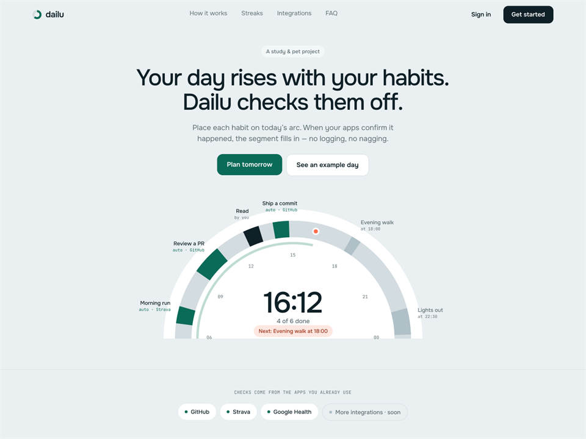
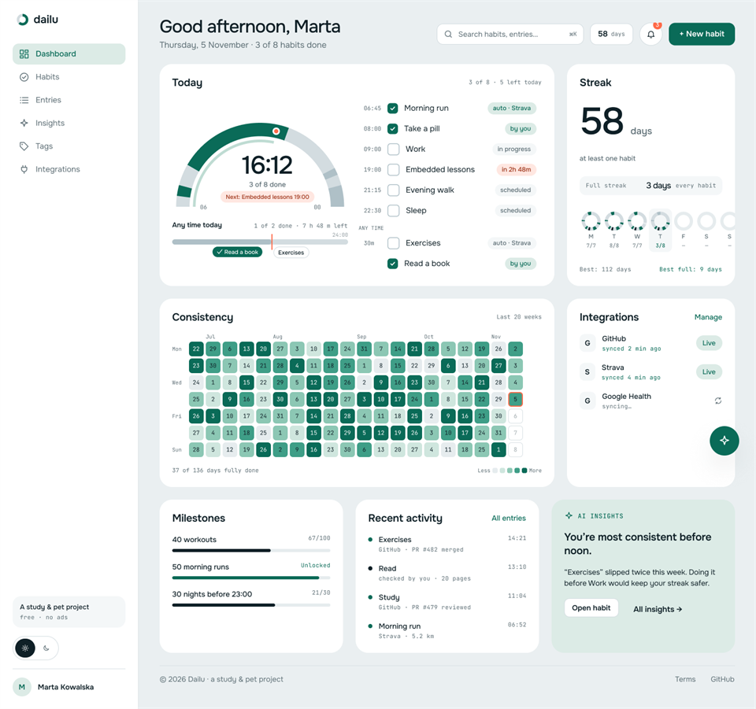
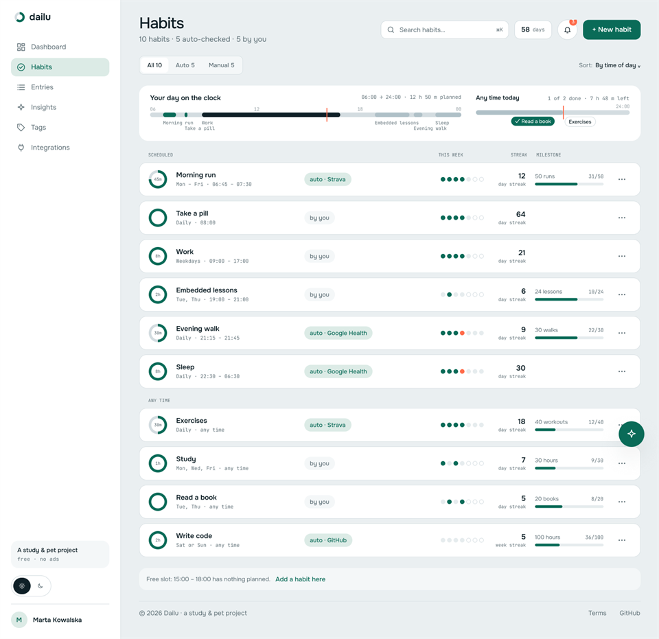
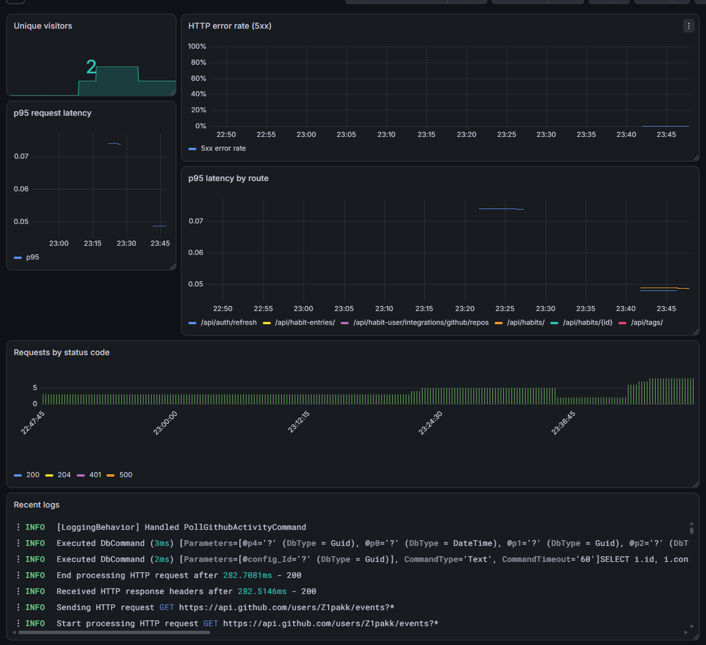
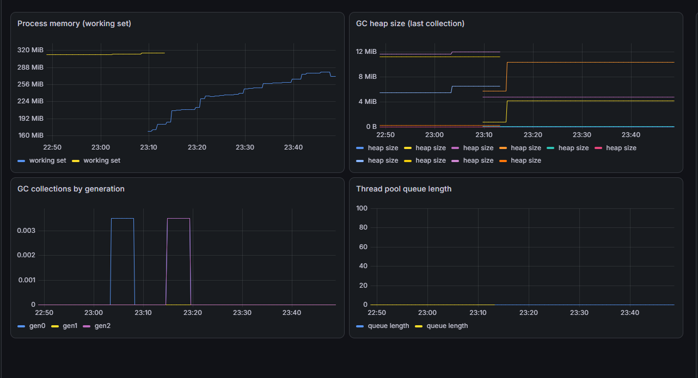

# Dailu

[](https://github.com/Z1pakk/dailu/actions/workflows/build.yml)
[](https://github.com/Z1pakk/dailu/actions/workflows/deploy.yml)

**A habit tracker that checks your habits off for you.** Live at [dailu.dev](https://dailu.dev).

Most habit apps fail the same way: you forget to open them. In Dailu you connect Strava, GitHub or
Google Health once, and when a run, a commit or a workout shows up, the habit ticks itself.

It's also my study project: a place to practise a modular .NET backend and a modern Angular app on
something real.

<p align="center"></p>

## What you can do

- **Track any habit.** Tick it off ("meditate"), or set an amount ("read 20 pages").
- **Plan it your way.** Every day, on picked weekdays, on days of the month, or just
  "2× a week, any days".
- **Give it a time.** Timed habits sit on a clock of your day; the rest wait in an "any time" lane
  until midnight.
- **Let apps do the logging.** Strava, GitHub and Google Health tick habits automatically.
- **Keep the streak.** Streaks, a yearly heatmap and milestones show how far you've come.
- **Group with tags.**

<table align="center">
  <tr>
    <td align="center"><br><sub>Dashboard page</sub></td>
    <td align="center"><br><sub>Habits page</sub></td>
  </tr>
</table>

## Run it locally

You need the .NET 10 SDK, Node.js and Docker.

```bash
# API + database (Aspire starts PostgreSQL for you)
cd Dailu/src/aspire/Dailu.AppHost && dotnet run

# Web app
cd Dailu/src/frontend/Dailu.ClientApp && npm install && npm start

# Monitoring: Grafana, Prometheus, Loki, Tempo (optional)
cd Dailu/observability && docker compose up
```

## How it's built

- **Backend:** .NET 10, ASP.NET Core minimal APIs, EF Core with PostgreSQL. It's a modular
  monolith: one app, split into independent modules (habits, entries, users, tags, identity) that
  only talk through clear contracts.
- **Frontend:** Angular 21 with signals, NGXS, PrimeNG and Tailwind.
- **Monitoring:** OpenTelemetry → Prometheus, Loki and Tempo, viewed in Grafana.
- **Deployment:** GitHub Actions builds and tests every pull request; merging to `main` deploys to
  a Hetzner server running [Dokploy](https://dokploy.com/).

Design notes live in [`Dailu/docs`](Dailu/docs), for example the
[habit schedule guide](Dailu/docs/guides/habit-schedule/README.md).

<details>
<summary>Monitoring screenshots</summary>

<p align="center">
  
  
</p>

</details>
